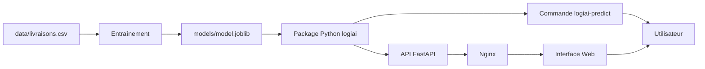

# Étude de conception — LogiAI

## 1. Besoin

LogiAI estime le risque de retard d'une livraison à partir de ses caractéristiques et fournit une prédiction exploitable par une interface ou une application cliente.

## 2. Données

Les données d'entrée sont issues de `data/livraisons.csv`. Les variables utilisées sont `distance_km`, `poids_kg`, `heure_depart`, `pluie_mm`, `trafic_index`, `nb_arrets` et `type_vehicule`. La cible est `retard`.

## 3. Modèle et métriques

Le projet utilise un modèle scikit-learn sauvegardé avec Joblib dans `models/model.joblib`. Les informations du modèle sont conservées dans `models/model_info.json`. Le seuil d'alerte configuré est de 0,4. Les métriques détaillées doivent être reprises depuis les résultats d'entraînement du projet.

## 4. Critères d'acceptation

- Le package peut être installé dans un environnement Python indépendant.
- Le module `logiai` peut être importé après installation.
- La commande `logiai-predict` est disponible.
- Les tests automatisés passent.
- La prédiction fonctionne lorsque le chemin des artefacts est correctement configuré.

## 5. Cycle de vie

Les données sont préparées, le modèle est entraîné et évalué, puis l'artefact est sauvegardé. Le package Python expose ensuite les fonctions de prédiction. Les évolutions du modèle et des dépendances doivent être testées avant une nouvelle distribution.

## 6. Architecture

Le package `logiai` regroupe la logique de prédiction et la configuration. Le modèle et les données restent des ressources externes au package et sont localisés grâce à `LOGIAI_HOME`. La commande CLI et l'API utilisent le même package. Dans le déploiement conteneurisé prévu par l'atelier, l'API et le serveur Web/Nginx sont exécutés dans des conteneurs distincts.

**État de validation :** le packaging et la commande CLI ont été testés localement. L'intégration Docker n'est pas encore validée dans le checkout actuel : aucun `Dockerfile` ni fichier Compose n'y est présent.

## 7. Choix technologiques

- Python pour le développement.
- scikit-learn et Joblib pour le modèle.
- setuptools et `pyproject.toml` pour le packaging.
- FastAPI pour l'API.
- pytest pour les tests automatisés.
- Docker Compose et Nginx pour le déploiement conteneurisé prévu.

## 8. Risques et éthique

Une prédiction est une estimation et ne garantit pas qu'une livraison sera en retard. Les données peuvent être incomplètes ou biaisées. Le résultat doit être interprété comme une aide à la décision, et non comme une certitude.

## 9. Limites

La qualité dépend des données d'entraînement et de leur représentativité. Le modèle doit être réévalué lorsque les conditions opérationnelles changent. Le modèle n'est pas inclus dans la distribution wheel : il doit être fourni séparément et le chemin `LOGIAI_HOME` doit pointer vers les ressources attendues.
